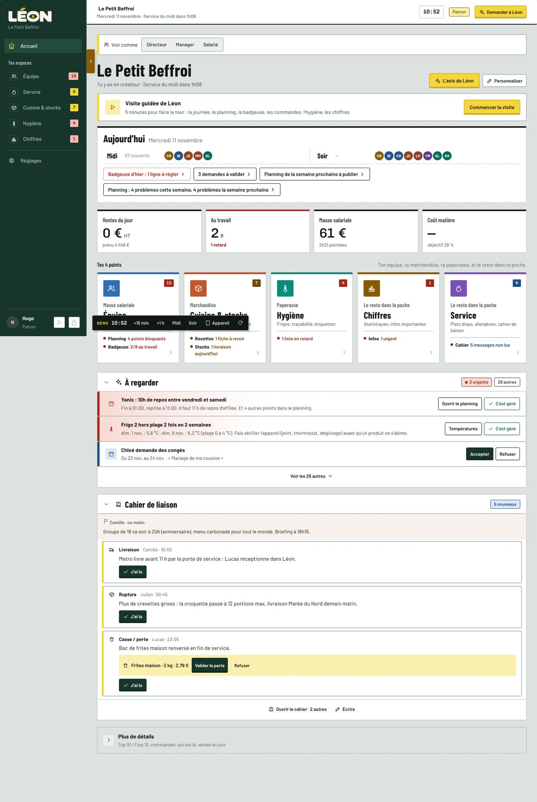
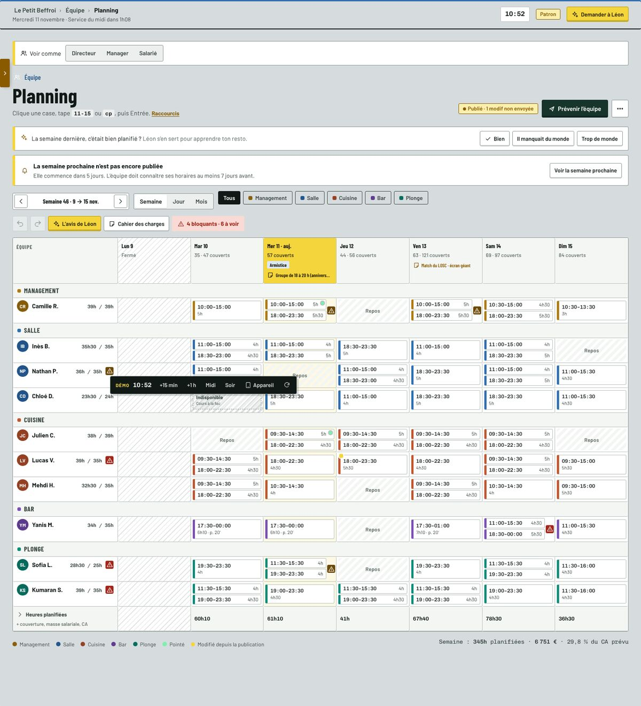
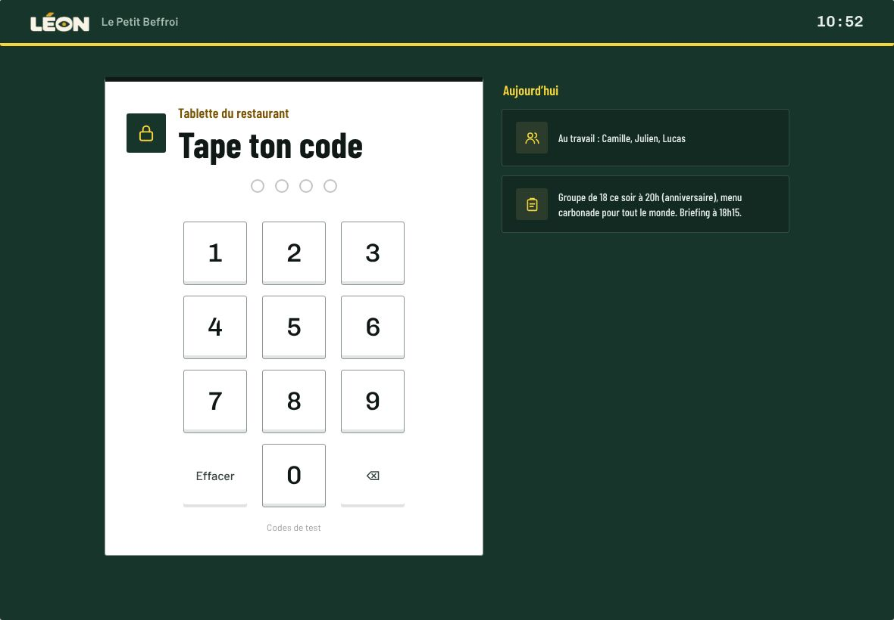
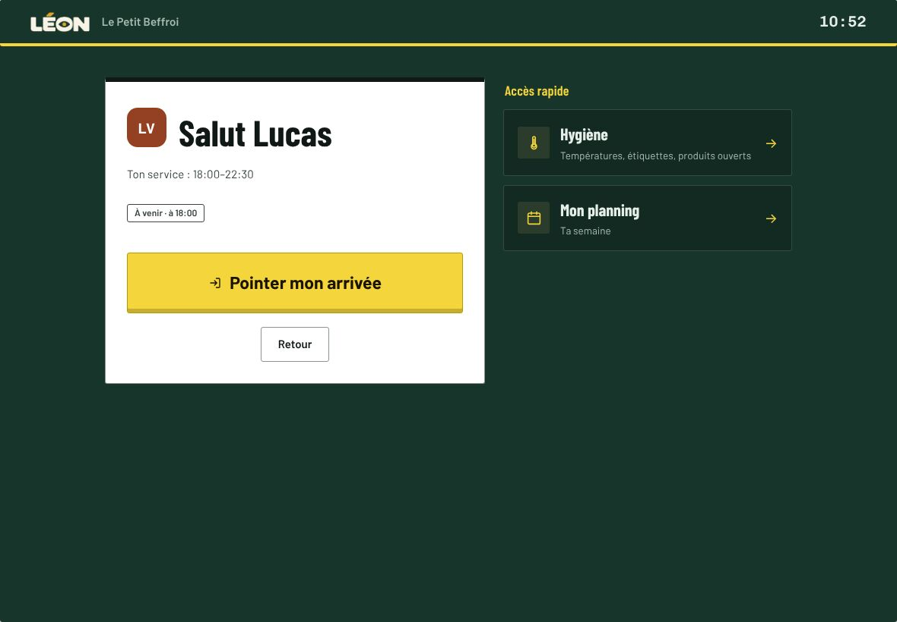
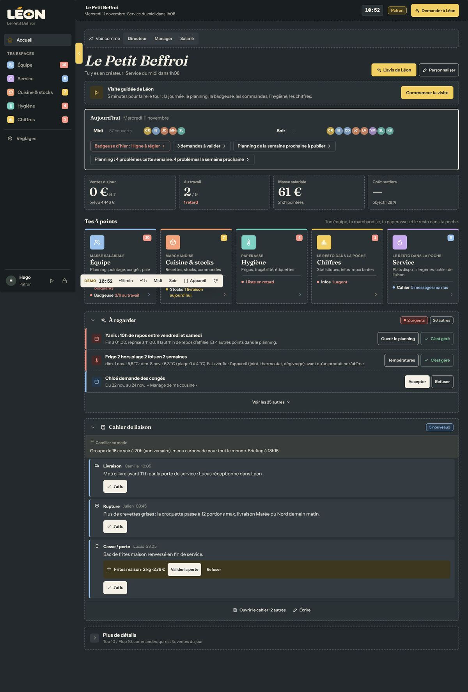
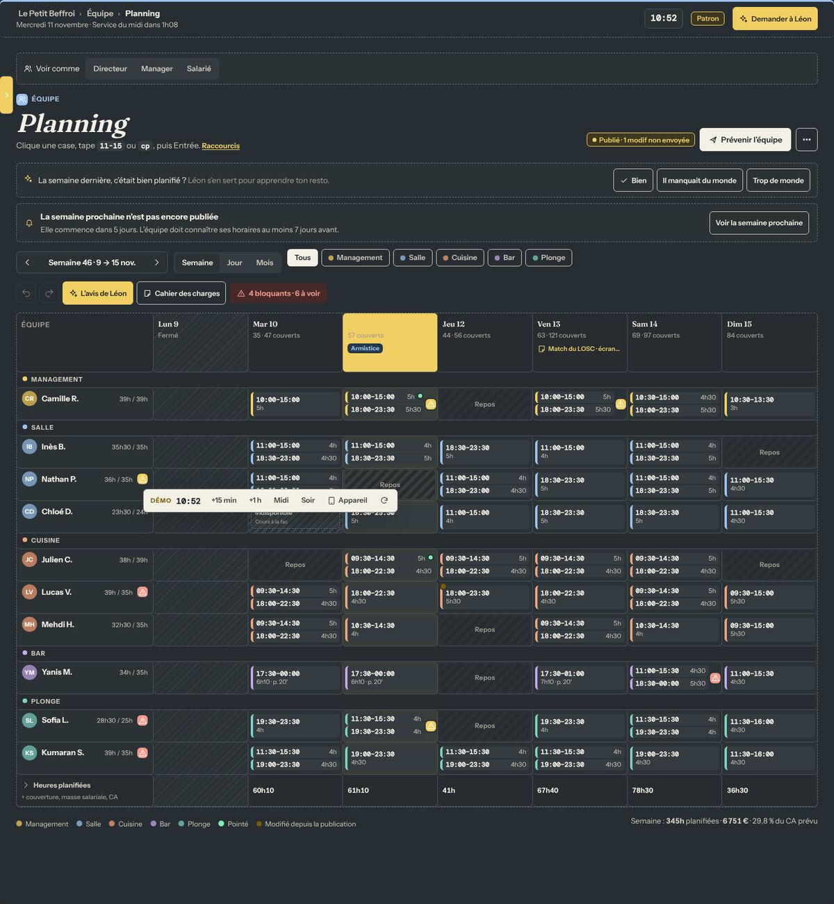
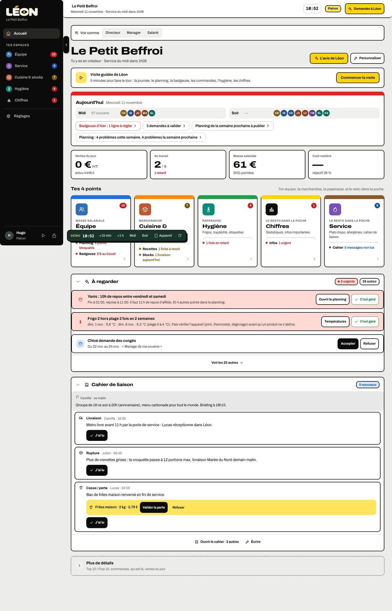
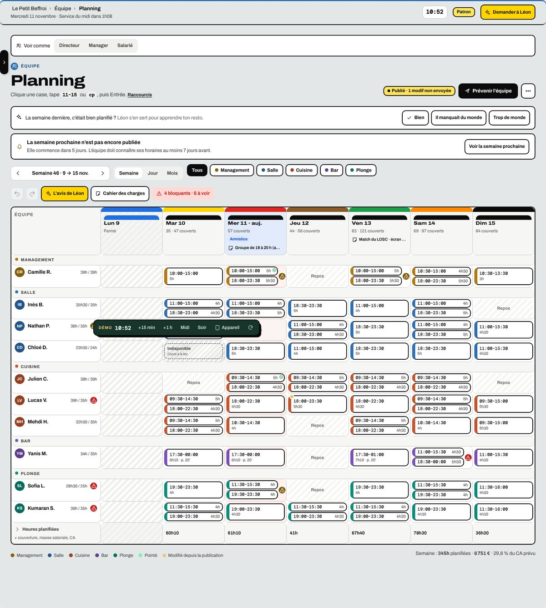
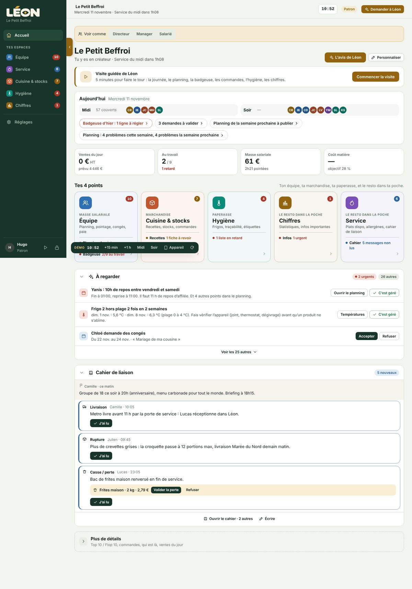
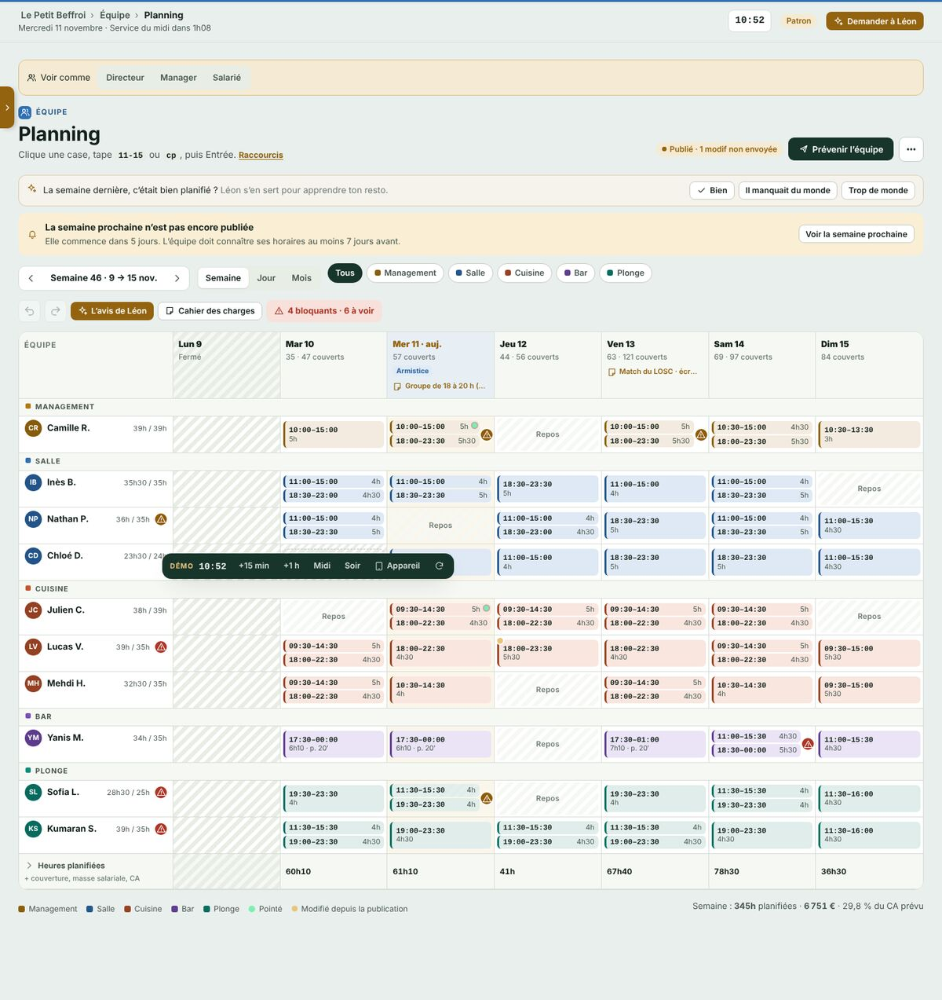

# Refonte du 11 novembre 2026 : les captures

## L'identité retenue : « Le bon » (piste A)
Léon ressemble à ce qu'on voit sur un passe : des bons blancs posés sur de l'inox.
Titres en lettres de plaque, chiffres en police de ticket, jaune « souche » pour agir, rouge pour l'urgent.

| Aujourd'hui | Planning |
|---|---|
|  |  |

| Tablette : le code | Tablette : badger |
|---|---|
|  |  |

Tous les écrans finaux : dossier [`final/`](final/) (22 captures : appli PC et téléphone, tablette, salarié, responsable, site, connexion, espace créateur).

## Les deux pistes non retenues
Elles sont gardées dans `legacy/pistes/`. Pour en essayer une : `LEON_PISTE=b npm run legacy` (ou `c`).
Elles ne sont faites que pour l'appli : si tu en choisis une, il faudra l'étendre au site et à la connexion.

### B · « L'ardoise »
Fond ardoise, écriture craie, titres en serif de menu. Très bistrot, mais moins lisible en plein jour.

| Aujourd'hui | Planning |
|---|---|
|  |  |

### C · « L'étiquette »
Tout est une étiquette de traçabilité : gros cadre noir et le code couleur des jours (lundi bleu, mardi jaune…).
Plus ludique, mais beaucoup de couleurs dans le planning.

| Aujourd'hui | Planning |
|---|---|
|  |  |

## Avant
Dossier [`avant/`](avant/). Ces captures ont été prises sans les polices de Google (bloquées là où je travaille) :
les lettres sont donc en police de secours, le reste est fidèle.

| Aujourd'hui | Planning |
|---|---|
|  |  |
